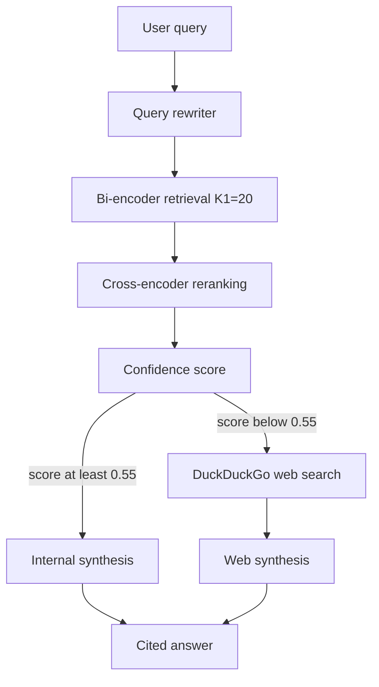

# Production RAG Pipeline

This project is a two-stage RAG helper for internal Campus Cloud docs. RAG means retrieval-augmented generation. The app first rewrites the question, then searches internal docs, then re-ranks the matches. If the best match looks weak, it searches the public web and cites the links.

## AI Transparency

AI was used to create part of this file and to clean up its writing and formatting.

## 1. System architecture



The rewriter turns a follow-up like "What are its system requirements?" into a full question when the earlier chat named Kubernetes Worker Nodes.

Stage 1 uses `all-MiniLM-L6-v2` and ChromaDB to fetch 20 chunks. Stage 2 uses `cross-encoder/ms-marco-MiniLM-L-6-v2` to score those chunks. The confidence value is a sigmoid of the top raw score. If that value is at least 0.55, the generator reads the top 3 internal chunks. If it is lower, the app queries DuckDuckGo and cites the URLs.

## 2. Installation and prerequisites

You need Python 3.11 or newer, [uv](https://docs.astral.sh/uv/), and some disk space for the local models. Docker Desktop is needed if you want the container demo.

```bash
uv sync
```

The first run downloads the embedding model and the cross-encoder. That can take a few minutes.

This project installs from `pyproject.toml`. Run `uv sync` on your computer. That command may create a local lock file. The lock file is ignored by git, so Mac and Linux installs do not conflict.

If you want longer written answers, start Ollama on your Mac and pull `llama3.2:3b`. The app still works without Ollama. In that case it builds a short cited answer from the source text.

## 3. Configuration and secrets

Copy the example env file only if you want to set optional values:

```bash
cp .env.example .env
```

`OPENAI_API_KEY` and `TAVILY_API_KEY` are listed because the assignment asked for those names. This project does not need them. Search uses DuckDuckGo. Embeddings and reranking run locally.

Optional lines you may add to `.env`:

- `OLLAMA_HOST=http://localhost:11434`
- `OLLAMA_MODEL=llama3.2:3b`

Do not put real keys in the project folder.

## 4. Threshold calibration rationale

The assignment example cutoff is 0.55 after the sigmoid step. I kept that cutoff. I then ran sample questions and recorded the top sigmoid score for each one.

| Question | Top score | Route |
| --- | --- | --- |
| How do I provision an isolated VPC in our staging environment? | 1.00 | INTERNAL_RAG |
| What are the system requirements for Kubernetes Worker Nodes? | 1.00 | INTERNAL_RAG |
| Can I use the older terraform modules we used last month for a new isolated VPC? | 1.00 | INTERNAL_RAG |
| What year did the James Webb Space Telescope release its first full-color science images? | 0.00 | WEB_FALLBACK |
| What was the root cause of the major AWS us-east-1 outage announced yesterday? | 0.00 | WEB_FALLBACK |

Internal questions scored 1.00. Questions outside the docs scored 0.00. The cross-encoder gives large positive or negative raw numbers, so after the sigmoid step the scores pile up near 1 or near 0. The 0.55 cutoff sits in the gap between those two groups.

If I raised the cutoff close to 1.00, a slightly weaker internal match could fall over to the web. If I lowered it close to 0, a weak internal match could block a better web answer. 0.55 stayed safe for every sample I ran.

## 5. How to run it

From the project folder in the VS Code terminal:

```bash
uv run streamlit run src/app.py
```

Then open the local URL that Streamlit prints, usually http://localhost:8501.

Run the tests with:

```bash
uv run pytest -v
```

Docker option, for the video demo:

```bash
docker compose up --build
```

The first Docker build downloads the models again inside the image, so run it once before you record. Do not also start the local Streamlit command at the same time. Both use port 8501.

The assignment lists `duckduckgo-search`. That package was renamed to `ddgs`, and the old package often returns no links. This project uses `ddgs`. It tries DuckDuckGo first. If that search comes back empty, it tries other free search backends so the web fallback can still cite real URLs.

## 6. AI audit log summary

The first draft had two serious problems. It treated raw cross-encoder scores as if they were already probabilities, so a cutoff of 0.55 did not mean what it should. It also pasted raw web text into the answer prompt, which is a prompt injection risk.

I fixed both issues. The reranker now runs each raw score through a sigmoid function. The generator wraps web text in `<external_web_source>` tags and strips instruction-like lines. I also added a content hash so the retriever does not insert the same docs twice on every restart.

The full notes and before and after snippets are in `ai_prompt_log.md`.
